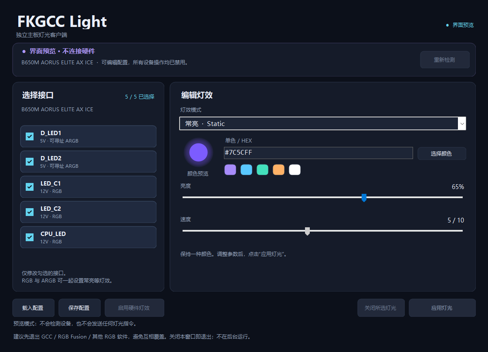

# FKGCC Light

[](https://github.com/shangwuqinu/FKGCC/actions/workflows/windows.yml)

**0.1.1 预览版：本机已目视确认红色生效和 0% 全部熄灯。各接口单独映射、非零亮度和动态灯效仍待逐项实测。**

面向 **GIGABYTE B650M AORUS ELITE AX ICE** 的独立 Windows 灯光客户端。通过系统 HID 接口直接控制主板，不依赖 GCC 主程序、GCC DLL 或自定义内核驱动。

这是对灯光功能的独立实现。硬件接口来自官方 GCC 组件的静态分析，并与 OpenRGB 源码和本机控制器回复交叉核对；不是把 GCC 整个运行环境搬进新窗口。

## 使用

[下载预览版](https://github.com/shangwuqinu/FKGCC/releases)；每次构建的 ZIP 和 SHA-256 校验文件也可从 [Actions](https://github.com/shangwuqinu/FKGCC/actions) 的 Artifacts 下载。

1. 运行 `dist/FKGCC.Light.exe`（绿色版解压后运行同名文件）。启动只查询主板及控制器信息，不改变灯效。
2. 勾选接口，选择灯效、颜色、亮度和速度，点击“应用灯光”。
3. 如果此前使用其他软件的逐灯模式，应用后灯光没有响应，可点“启用硬件灯效”，再应用。这个按钮会同时切换两条 ARGB 的效果引擎，并关闭音频同步。
4. “保存配置”和“载入配置”只读写本地 XML；载入后仍需手动应用。“关闭所选灯光”仅针对勾选接口。

GCC、RGB Fusion、OpenRGB、SignalRGB 同时运行时，客户端会拒绝写入并提示先退出冲突程序。关闭窗口即退出；没有后台服务和自动启动项。

## 范围

| 接口 | 类型 | 功能 |
| --- | --- | --- |
| D_LED1、D_LED2 | 5V ARGB | 常亮、呼吸、闪烁、循环变色、关闭 |
| LED_C1、LED_C2 | 12V RGB | 同上 |
| CPU_LED | 12V RGB | 同上 |

可分接口、同时选择多个接口；亮度 0–100%，速度 1 最慢、10 最快。**0% 和“关闭”均使用 GCC 的常亮黑色关灯方式**，保留编辑器中的颜色与灯效设置；重新调高亮度并应用可恢复所选效果。呼吸效果在协议层使用该控制器的 100 亮度上限。逐灯编辑、音频同步、休眠/断电持久化、其他主板/内存/显卡不在此版范围。

支持目标：Windows 10/11 x64，.NET Framework 4.8。已在当前 Windows 11 机器运行并识别固件 **4.0.31.2**。程序以普通权限启动，不请求 UAC。

## 验证结果

- 核心协议、严格输入校验、配置读写、断连中止、CLI dry-run 与预览界面共 39 项自动检查通过，包含 0% 关灯回归检查。
- 独立 EXE 已实际查询到 `048D:5702 / FF89:00CC / 64 bytes`、设备编号 0。
- 最初两轮仅操作 D_LED 的测试均未见变化。全选五路并发送红色、亮度字段 0 后，用户确认灯变红却未熄灭；因此不能将协议亮度字段 0 直接当作关闭。
- 0.1.1 将所有效果的 0% 和关闭统一编码为 GCC 的 **常亮黑色**。同样全选五路再应用后，用户确认 **全部熄灭**。这证明本机实际灯光可受独立客户端控制，但不能证明每个接口的单独映射、所有非零亮度或动态效果均已验证。
- 正常应用不重置控制器、不写 Flash、不修改校准或灯珠数量。设备中途失败会中止并报告状态未确认，不会把不完整事务显示为成功。

截图为不访问硬件的界面预览：



## 命令行

以下命令从源码目录运行；绿色版在解压目录中将 `.\dist\` 改为 `.\`。

```powershell
# 查询身份；CC60 查询事务不改变灯效
.\dist\FKGCC.Cli.exe probe

# 只输出报文，不访问硬件
.\dist\FKGCC.Cli.exe apply --headers D_LED1,D_LED2 --mode static --color '#7C5CFF' --brightness 40 --dry-run

# 实际应用；不加 --headers 时选择全部五个物理接口
.\dist\FKGCC.Cli.exe apply --headers D_LED1 --mode breathing --color '#3080FF' --brightness 60 --speed 4

# 显式接管两条 ARGB 的硬件效果引擎，再应用
.\dist\FKGCC.Cli.exe take-control

# 关闭全部五个接口；任意灯效的 --brightness 0 同样使用黑色关灯
.\dist\FKGCC.Cli.exe apply --mode off

# 从本地配置应用，也支持 --dry-run
.\dist\FKGCC.Cli.exe profile .\my-light.xml
```

模式：`off`、`static`、`breathing`、`blink`、`cycle`。退出码：0 已接受；2 输入无效；3 操作失败；4 检测不到受支持的设备。运行日志位于 `%LOCALAPPDATA%\FKGCC-Light\client.log`，最大约 2 MB 后轮换。

## 开发

```powershell
.\scripts\test.ps1
.\scripts\build.ps1
.\scripts\package.ps1
```

使用 Windows 自带的 .NET Framework C# 编译器，无 NuGet 依赖，不需要安装 .NET SDK。源码采用 C# 5 语法。

- `src/Core.cs`：板型、接口、报文编码和配置文件。
- `src/Hardware.cs`：SetupAPI/HID 枚举、身份校验、串行提交、错误处理。
- `src/Desktop.cs`：中文桌面界面；`src/Cli.cs`：可审计的命令行。
- [逆向分析与证据](docs/REVERSE-ENGINEERING.md)：GCC 组件边界、REA Evidence、已知限制。

项目代码按 GPL-2.0-or-later 提供，见 `LICENSE` 和 `THIRD_PARTY_NOTICES.md`。发行包不包含技嘉安装器或 DLL；研究产物保留在本地 `research/`。

## GitHub Actions

推送 `main`、提交 PR 或手动运行工作流，会在 GitHub 的 Windows 2025 托管运行器上执行测试、编译 GUI/CLI，并上传包含源码的便携 ZIP 和 `SHA256SUMS.txt`。CI 仅运行硬件无关测试和 `--dry-run`，不访问实际主板。

发布版本时更新 `src/app.manifest` 的版本号、本文版本说明和 `docs/RELEASE-NOTES.md`。在 Actions → **Windows build and release** → **Run workflow** 勾选 `publish`，测试通过后会创建预览 Release。也可以推送对应标签，例如 `v0.1.1-preview`，自动构建并发布；标签必须与清单版本一致。已存在的 Release 不会被自动覆盖。

工作流默认只有仓库读取权限，发布任务单独获得 `contents: write`，直接使用 GitHub 自动提供的 token，无需添加个人访问令牌。第三方 Action 固定到提交 SHA。

## 贡献者

**shangwuqinu、ChatGPT（OpenAI）**。具体分工见 [AUTHORS.md](AUTHORS.md)，上游署名见 [THIRD_PARTY_NOTICES.md](THIRD_PARTY_NOTICES.md)。
